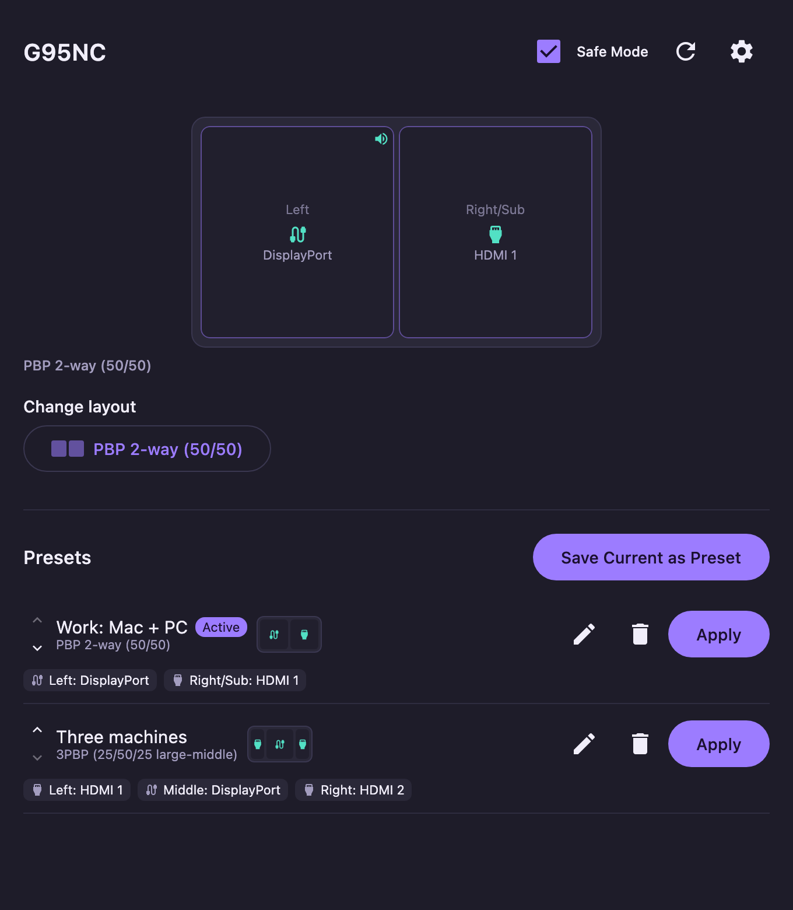
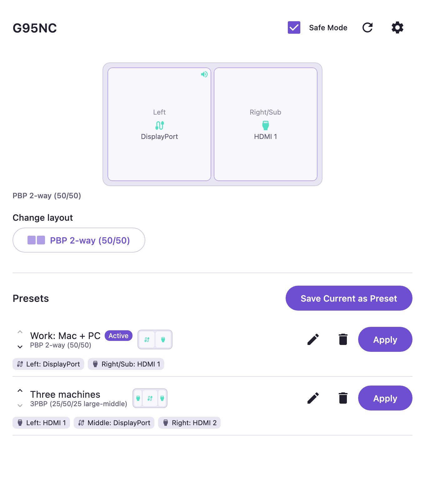
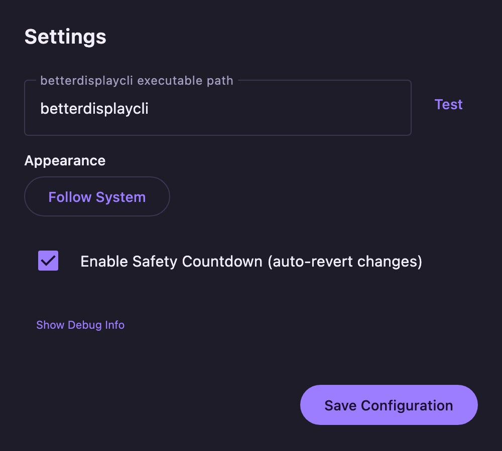

# G95NC DDC/CI Controller App

A lightweight, standalone Desktop application built with Kotlin and Compose Multiplatform to control the Samsung Odyssey G95NC monitor (PBP layouts, inputs, and audio sources) across Windows, Linux, and macOS.

This app is a frontend and extension of the reverse-engineered scripts from the [g95nc-ddc](https://github.com/mwd102/g95nc-ddc) repository.

> [!WARNING]
> **Experimental and vibe-coded.** This app was built largely with AI assistance ([Claude Code](https://claude.com/claude-code)) as a personal project. It works on my setup, but it sends raw DDC/CI commands to your monitor - use it at your own risk, and expect rough edges.

> [!NOTE]
> **Windows is untested.** The Windows build (native DXVA2 backend and `.msi` installer) has never been run on real Windows hardware. It may work; it may not. Reports and fixes are very welcome.

<p align="center">
  
  
</p>
<p align="center">
  
</p>

## Features
- **Cross-Platform**: Runs on Windows, Linux, and macOS.
- **System Tray / Menu Bar**: Lives in the tray for quick access.
- **Presets**: Save and quickly apply your favorite layout and source combinations with one click.
- **Standalone on Windows**: Uses JNA to bind directly to the Win32 `dxva2.dll` API — no Python or vendor software required.
- **Linux & macOS**: Seamlessly integrates with `ddcutil` and `betterdisplaycli`.

## Download
Prebuilt installers are attached to every [GitHub Release](../../releases/latest):

| OS | File |
|---|---|
| macOS (Apple Silicon) | `G95NC-Controller-<version>-macos-arm64.dmg` |
| macOS (Intel) | `G95NC-Controller-<version>-macos-x64.dmg` |
| Windows (untested) | `G95NC-Controller-<version>-windows-x64.msi` |
| Linux (Debian/Ubuntu) | `G95NC-Controller-<version>-linux-x64.deb` |
| Linux (Fedora/openSUSE) | `G95NC-Controller-<version>-linux-x64.rpm` |

The builds are **not code-signed**. On macOS, right-click the app and choose *Open* the first time
(or run `xattr -dr com.apple.quarantine "/Applications/G95NC Controller.app"`); on Windows,
SmartScreen will ask you to confirm under *More info -> Run anyway*.

## Requirements
- **Windows**: No external requirements.
- **Linux**: [ddcutil](https://www.ddcutil.com/) must be installed.
- **macOS**: [betterdisplaycli](https://github.com/waydabber/betterdisplaycli) must be installed.

## Building and Running
The app is built using Gradle and Compose Multiplatform.

To run the app directly:
```bash
./gradlew run
```

To package a standalone executable/installer for your current OS:
```bash
./gradlew package
```
(This will output to `build/compose/binaries/main/`)

To run the tests:
```bash
./gradlew test
```

The README screenshots are rendered off-screen from fake monitor state (no monitor needed):
```bash
./gradlew test --tests '*ScreenshotGenerator*' -PscreenshotsDir=docs/screenshots
```

## Releasing
CI runs the tests on Linux, macOS and Windows for every push and pull request. To publish a
release, bump `appVersion` in `build.gradle.kts` and `AppInfo.VERSION` to the same value, commit,
then push a matching tag:
```bash
git tag v1.0.0 && git push origin v1.0.0
```
The [Release workflow](.github/workflows/release.yml) builds the installers on each OS and attaches
them to a new GitHub Release.

## Architecture
- `MonitorController`: Interface defining the core interactions.
- `Win32Dxva2Controller`: JNA implementation for Windows. No automated test coverage exists for
  this one (unlike the other two, which are exercised via a fake command runner) - exercising it
  means either a real Windows box or mocking the JNA interface itself. Correctness here currently
  relies on manual testing on real Windows hardware.
- `DdcutilController`: `ProcessBuilder` implementation for Linux.
- `BetterDisplayCliController`: `ProcessBuilder` implementation for macOS.

## Debug mode
Settings has a collapsed-by-default "Show Debug Info" section (not shown prominently, since it's
meant for development/troubleshooting rather than everyday use) that reads and displays the raw
values of every VCP code this app knows about, including six seen on the wire but never decoded
(see [INVESTIGATIONS.md](INVESTIGATIONS.md)). It only reads - it never writes - so it's safe to
use freely while diagnosing an issue.

## Design notes
- **No background status polling, by design.** The dashboard fetches the monitor's status once
  when it opens, and otherwise only re-fetches on an explicit user action (Refresh, applying a
  layout/source/preset). It deliberately does **not** poll on a timer to keep itself in sync with
  changes made outside the app (e.g. switching inputs from the monitor's own remote/OSD). DDC/CI
  is a slow, easily-congested channel on every OS this app targets - background polling would mean
  three cross-platform code paths (a subprocess spawn on Linux/macOS, a native DXVA2 call on
  Windows) continuously contending with the monitor's own on-screen menu and with each other. If
  the on-screen state and the app's displayed state drift apart, hit Refresh.

## Known limitations / open investigations
This README stays focused on installing and using the app. Real-hardware findings, unresolved
DDC/CI protocol questions, and deliberately-deferred fixes (3-way PBP status decoding, an
Off/Single Source false-read quirk, DDC/CI channel degradation under heavy use, undecoded VCP
codes, HDMI 3 confirmation, and a 3-way settle-delay TODO) have moved to
[INVESTIGATIONS.md](INVESTIGATIONS.md).

## Parked ideas (not yet decided)
- **Keyboard shortcuts** for common actions (layout/source switching, presets). Not yet
  implemented - still needs a decision on scope (global tray-level shortcuts vs. just within the
  open dashboard window) before it's worth picking a shortcut scheme.

## Credits
The DDC/CI protocol details this app relies on (VCP codes, PBP layouts, source values) come from
the reverse-engineering work in [g95nc-ddc](https://github.com/mwd102/g95nc-ddc) by Michael Dobson,
licensed under MIT. Thanks for doing the hard part!

## License
[MIT](LICENSE) - includes the upstream g95nc-ddc license notice.
